# Architecture — the outreach "department"

## Short answer

**You already have the department.** The system is a classic
**Orchestrator–Workers** design: `OutreachAgent` (in `agent.py`) is the "boss"
that delegates to a team of specialists, each a module with a single job.
Since the split of `agent.py`, the boss is a facade over four stage classes:
`LoopOrchestrator` runs the loop, `DispatchPipeline` holds the one send check
every send path runs, `BacklogDrainer` works the backlog, follow-ups and
retries, and `ExclusionManager` keeps the client and competitor lists.

The real question isn't _"one agent vs. a department"_ — it's _"should each
specialist be a deterministic **worker** (plain code) or an autonomous **LLM
agent** (reasons with a model)?"_ Applying the `agentic-workflow-guide`
framework (Primitive First; prefer the lowest escalation level; **offload
deterministic work to scripts, not LLM loops**), the answer for this system is:

> Keep the deterministic specialists as code. Reserve true LLM "agents" for the
> 2–3 genuinely cognitive roles — and only once a working model key exists.

Turning the deterministic workers into LLM agents would trade cheap, fast,
**testable** (about 5,000 tests in the default `py -3.15 -m pytest` run, plus
about 130 browser tests under `-m ui`) function calls for costly, slow,
non‑deterministic model calls - and those only work while the company's own
model server is up (an OpenAI-compatible server such as Ollama on Omega IFS's
own machine or private network, via `LLM_PROVIDER=openai_compatible`; no
cloud AI service is supported; `py -3.15 main.py doctor` reports the server).

## The org chart

```mermaid
flowchart TD
    Boss["OutreachAgent facade + LoopOrchestrator + DispatchPipeline<br/>(discovery loop, delegation, the send check, stop conditions)"]

    subgraph Workers["Deterministic workers — code (reliable, tested, free)"]
        Research["Researcher<br/>search.py + query_generator.py"]
        Verify["Verifier<br/>verification.py"]
        Score["Scorer<br/>lead_scoring.py"]
        Gate["Relevance Gate<br/>relevance.py"]
        Dispatch["Dispatcher<br/>email_sender.py"]
        Follow["Follow-up Rep<br/>sequences.py"]
        Inbox["Inbox Monitor<br/>imap_monitor.py"]
        Throttle["Compliance/Throttle<br/>warmup.py + domain_throttle.py + blacklist.py<br/>compliance.py + unsubscribe.py + retention.py"]
        Objections["Objection Keeper<br/>company_block.py + optout_spool.py"]
        Retry["Retry Clerk<br/>retry_queue.py"]
        Records["Records/Analytics<br/>database.py + analytics.py<br/>backup.py + journal.py"]
        Backlog["Backlog Clerk<br/>backlog_draining.py"]
        Exclusions["Exclusions<br/>exclusion_manager.py + clients.py"]
        Triage["Reply Triage<br/>reply_intent.py"]
        Learner["Learner<br/>learning.py"]
        Explainer["Explainer<br/>contact_explainer.py"]
        Export["GDPR Export<br/>export.py"]
        Linter["Template Linter<br/>deliverability.py"]
    end

    subgraph Cognitive["Cognitive specialists — LLM (dormant: needs a working key)"]
        Strategist["Strategist<br/>where to hunt next"]
        Copywriter["Copywriter<br/>openers and whole email bodies"]
        Analyst["Analyst<br/>relevance + reply triage"]
    end

    Boss --> Research
    Boss --> Verify
    Boss --> Score
    Boss --> Gate
    Boss --> Dispatch
    Boss --> Follow
    Boss --> Inbox
    Boss --> Throttle
    Boss --> Objections
    Boss --> Retry
    Boss --> Records
    Boss --> Backlog
    Boss --> Exclusions
    Boss --> Triage
    Boss --> Learner
    Boss --> Explainer
    Boss --> Export
    Boss --> Linter
    Boss -. "needs a working LLM key" .-> Strategist
    Boss -. "needs a working LLM key" .-> Copywriter
    Boss -. "needs a working LLM key" .-> Analyst
```

## Who does what

| Role                    | Module(s)                                                                                            | Kind                | Why it stays this way                                                                                                                                                                                                                                 |
| ----------------------- | ---------------------------------------------------------------------------------------------------- | ------------------- | ----------------------------------------------------------------------------------------------------------------------------------------------------------------------------------------------------------------------------------------------------- |
| **Boss / Orchestrator** | `agent.py`, `loop_orchestration.py`, `dispatch_pipeline.py`                                          | Orchestrator        | `agent.py` builds the workers and delegates; `LoopOrchestrator` runs the loop, discovery, reputation guards and stop conditions; `DispatchPipeline.send_verdict` is the one send check (warm-up, domain caps, backoff, screens) every send path runs  |
| **Researcher**          | `search.py`, `query_generator.py`                                                                    | Deterministic       | DuckDuckGo + scraping + free query generation — no reasoning needed                                                                                                                                                                                   |
| **Verifier**            | `verification.py`                                                                                    | Deterministic       | DNS/MX/SMTP checks are exact, not judgement calls                                                                                                                                                                                                     |
| **Scorer**              | `lead_scoring.py`                                                                                    | Deterministic       | Transparent, tunable rules beat opaque model scores                                                                                                                                                                                                   |
| **Relevance Gate**      | `relevance.py`                                                                                       | Deterministic       | Cheap geo/vertical/negative gate; runs before any cost                                                                                                                                                                                                |
| **Dispatcher**          | `email_sender.py`                                                                                    | Deterministic       | SMTP assembly + send must be exact and idempotent                                                                                                                                                                                                     |
| **Follow-up Rep**       | `sequences.py`                                                                                       | Deterministic       | Date math + state machine, not reasoning                                                                                                                                                                                                              |
| **Inbox Monitor**       | `imap_monitor.py`                                                                                    | Deterministic       | Classify bounce/reply/unsub by rules                                                                                                                                                                                                                  |
| **Compliance/Throttle** | `warmup.py`, `domain_throttle.py`, `blacklist.py`, `compliance.py`, `unsubscribe.py`, `retention.py` | Deterministic       | Rate limits and blocklist checks must be exact for reputation; the legal footer, opt-outs and retention are legal obligations (GDPR, D.Lgs. 70/2003)                                                                                                  |
| **Objection Keeper**    | `company_block.py`, `optout_spool.py`                                                                | Deterministic       | An objection must hold: a company block stops every address at its domain, and an opt-out that met a busy database waits on disk until it is applied                                                                                                  |
| **Retry Clerk**         | `retry_queue.py`                                                                                     | Deterministic       | Exponential backoff scheduling                                                                                                                                                                                                                        |
| **Records/Analytics**   | `database.py`, `analytics.py`, `backup.py`, `journal.py`                                             | Deterministic       | Source of truth; SQLite transactions; checked backups, and a journal of opt-outs, blocks, bounces, erasures and emails sent that a restore replays                                                                                                                          |
| **Backlog Clerk**       | `backlog_draining.py`                                                                                | Deterministic       | Qualifies the backlog (only when a send can follow) and runs the follow-up and retry passes                                                                                                                                                           |
| **Exclusions**          | `exclusion_manager.py`, `clients.py`                                                                 | Deterministic       | Active clients and named competitors, reloaded when the spreadsheets change                                                                                                                                                                           |
| **Reply Triage**        | `reply_intent.py`                                                                                    | Deterministic       | Rules decide whether a reply is interested; only unclear ones go to the LLM                                                                                                                                                                           |
| **Learner**             | `learning.py`                                                                                        | Deterministic       | Biases discovery toward terms and countries that worked                                                                                                                                                                                               |
| **Explainer**           | `contact_explainer.py`                                                                               | Deterministic       | Why a contact was or wasn't emailed, for the dashboard                                                                                                                                                                                                |
| **GDPR Export**         | `export.py`                                                                                          | Deterministic       | Access export and erasure for one address                                                                                                                                                                                                             |
| **Template Linter**     | `deliverability.py`                                                                                  | Deterministic       | Advisory spam-word and structure checks on templates                                                                                                                                                                                                  |
| **Strategist**          | `ai_generator.suggest_discovery_queries`                                                             | **Cognitive (LLM)** | Built + dormant (`ai_strategist_enabled`); picks next discovery queries, informed by `_discovery_focus_hint`. It falls back first to AI company discovery (`generate_companies`, which runs on a key alone, with `TARGET_QUERIES` as its topics, and is skipped while that is blank, the default), then to the free generator               |
| **Copywriter**          | `ai_generator.generate_opening_line`, `ai_generator.generate_email_body`                             | **Cognitive (LLM)** | Tailored openers (`ai_personalization_enabled`) and whole AI-written bodies (`ai_humanize_emails`), only in a template that asks for `{{opening_line}}` or `{{body}}`; the shipped templates, Omega IFS's fixed text in Italian and English, ask for neither. Both fall back to hand-written copy |
| **Analyst**             | `ai_generator.classify_relevance` + reply triage                                                     | **Cognitive (LLM)** | Nuanced target/no-target — wired (`ai_relevance_enabled`); reply-draft suggestions still to build                                                                                                                                                     |

The dashboard: the main app is now at `/` (screens Today, Review,
Leads, Markets); the full dashboard these docs describe is at
`/classic`.

## Escalation plan (the framework's L0→L3)

- **Now (L2 — single orchestrator + worker library):** where we are. Correct
  for a mostly-deterministic pipeline. Keep.
- **Later (L2.5 — orchestrator + a thin cognitive layer):** when a real model
  key exists, activate the 3 cognitive specialists **as delegated helpers the
  boss calls**, not as autonomous peers. This is where the "team of agents"
  metaphor actually pays off — reasoning tasks get a brain; everything else
  stays deterministic. Each already has a safe non-AI fallback, so the system
  degrades gracefully.
- **Probably never (L3 — full autonomous multi-agent):** independent LLM agents
  messaging each other. For cold B2B outreach this adds cost, latency, and
  failure modes without improving the outcome (booked meetings). The
  framework's review gate — _"new additions only after delete/merge/split/move
  are checked"_ — argues against it here.

## Recommendation (classified per the framework)

- **KEEP** the Orchestrator–Workers structure and all deterministic specialists.
- **ADD (built, dormant)** the thin cognitive layer (Strategist / Copywriter /
  Analyst). The Strategist, the Copywriter, the Analyst's relevance check and
  the reply-intent tie-breaker sit behind flags (`ai_strategist_enabled`,
  `ai_personalization_enabled` / `ai_humanize_emails`, `ai_relevance_enabled`,
  `ai_reply_classification_enabled`). Every call that carries a recipient's
  data, which is all of them but the Strategist's, is also skipped while
  `AI_DPA_REFERENCE`, where the provider's processing agreement is filed, is
  blank. AI company discovery runs on a key alone, in the continuous loop,
  while `TARGET_QUERIES` gives it topics (blank by default, so it is skipped).
  Reply-draft suggestions for the Analyst are the remaining piece.
- **DO NOT** convert deterministic workers into LLM agents.
- **Blocker to check:** the cognitive layer runs only with a working model
  server of the company's own: `LLM_PROVIDER=openai_compatible` sends the
  chat-completions call to `LLM_BASE_URL` with `LLM_MODEL` (DEPLOY.md
  section 11), and only to an address on this machine or the private
  network. `LLM_PROVIDER` is read in any case, and a value other than blank
  or `openai_compatible` stops start-up (no cloud AI service is supported). `py -3.15 main.py doctor` reports whether
  the configured provider is set up and names its model; for a server of the
  company's own it also asks the server whether it lists that model.
